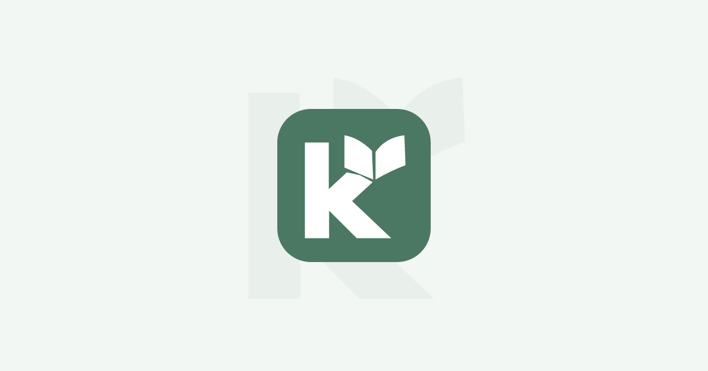

# Knowlify



Knowlify is a self-hosted, local-first library for ebooks. It reads PDF and EPUB files in a web or desktop app and keeps your notes, tags and reading progress.

License: AGPL-3.0-only. See [License](#license).

## What it does

- **Library.** Upload PDF and EPUB files, or index source folders in place. Knowlify reads covers and metadata in the background. View the library as a grid or a table.
- **Source folders.** Knowlify indexes these folders as read-only. It never writes to them and never deletes files in them.
- **Book details and metadata.** Edit title, author, description, ISBN, year, publisher, language, series and cover. Your edits do not change the book files. You can reset them. You can also search Open Library, with Google Books as a fallback, when you ask for it.
- **Favorites and tags.** Star books, add colored tags, and filter the library by favorite, tag, format, author, source folder, notes and reading state.
- **Reader.** Read EPUB and PDF files in the browser or in the desktop app. The reader saves your position.
- **Notes.** Save notes and quotes for each book. Search notes across all books.
- **Search.** Knowlify indexes the book text. Search finds passages by keyword. With embeddings enabled, search also finds passages by meaning.
- **Tutor (optional).** Connect an LLM to ask questions about one book or the whole library. Answers cite passages from your books. Open the tutor with Alt+T.
- **MCP server.** Connect Claude Code, Cursor or Claude Desktop to your library.
- **OPDS and KOSync.** Browse the library and sync reading progress from KOReader.
- **News (RSS).** Follow topics and feeds that you choose, and save articles to read later.
- **Desktop app.** The Tauri app runs a local server or connects to a remote server.
- **Accounts.** Knowlify has one user. Change the password in Settings.

## Quick start with Docker

Docker Compose builds the image from this repository.

1. Copy the example environment file: `cp .env.example .env`
2. Open `.env`. Set `KNOWLIFY_PASSWORD` to a password that only you know.
3. Set `KNOWLIFY_LIBRARY_DIR` to the host folder that holds your ebooks.
4. Build and start the container: `docker compose up -d --build`
5. Open `http://localhost:8787`. Sign in with `KNOWLIFY_USER` and `KNOWLIFY_PASSWORD`.
6. Open **Settings**, then **Folders**. Add `/library` as a source folder.

The container stores the database, uploaded books and covers in `./data`.

The container mounts `KNOWLIFY_LIBRARY_DIR` at `/library` as read-only. You can use a network share. Mount the share on the host first, then set `KNOWLIFY_LIBRARY_DIR` to the mount point.

To run a published image instead of a local build, use this service definition. Replace the placeholder with the registry and owner of your image.

```yaml
services:
  knowlify:
    image: <registry>/<owner>/knowlify:latest
    ports:
      - "8787:8787"
    environment:
      KNOWLIFY_PASSWORD: ${KNOWLIFY_PASSWORD:?set KNOWLIFY_PASSWORD}
      KNOWLIFY_LIBRARY_PATHS: /library
    volumes:
      - ./data:/data
      - /path/to/ebooks:/library:ro
    restart: unless-stopped
```

The image stores its data in `/data`. Mount a volume there to keep your data.

To see the running version and commit, open `/api/about` after you sign in.

## Configuration

Set variables in `.env`. The file `.env.example` lists every variable with comments.

| Variable | Required | Default | Purpose |
| --- | --- | --- | --- |
| `KNOWLIFY_PASSWORD` | Yes (Docker Compose) | none | Initial password. Compose stops if it is empty. |
| `KNOWLIFY_USER` | No | `admin` | User name. |
| `KNOWLIFY_LIBRARY_DIR` | No | `./library` | Host folder that Compose mounts read-only at `/library`. |
| `KNOWLIFY_PORT` | No | `8787` | Host port that Compose publishes. |
| `KNOWLIFY_SCAN_INTERVAL` | No | `600` | Seconds between source folder scans. `0` turns scans off. |
| `KNOWLIFY_BROWSE_ROOTS` | No | `KNOWLIFY_LIBRARY_PATHS` | Folders that the folder picker can open and that you can add as sources. `any` allows all folders. |
| `KNOWLIFY_INDEXING` | No | `on` | `off` turns the passage index off. |
| `KNOWLIFY_EMBEDDINGS` | No | `local` | `none`, `local` or `http`. `local` downloads a model of about 120 MB on first use. |
| `KNOWLIFY_LLM_URL`, `KNOWLIFY_LLM_API_KEY`, `KNOWLIFY_LLM_MODEL` | No | none | Enable the tutor. You can also set the LLM in Settings. |
| `KNOWLIFY_SECRET` | No | generated | Secret of at least 32 characters. It encrypts the LLM key and signs list cursors. |
| `KNOWLIFY_METADATA_LOOKUP` | No | `on` | `off` turns off online metadata search and cover download by URL. A value saved in Settings overrides it. |
| `KNOWLIFY_GOOGLE_BOOKS_API_KEY` | No | none | Optional Google Books API key. A key saved in Settings overrides it. |
| `KNOWLIFY_METADATA_LOCKED` | No | `0` | `1` locks the toggle and the key to the environment. `PUT /api/settings/metadata` returns `403`. |
| `KNOWLIFY_MCP` | No | `on` | `off` removes the `/mcp` route. |
| `KNOWLIFY_TRUST_PROXY` | No | `off` | `on`, a hop count, or a list of proxy IPs/CIDRs. Use it only behind a reverse proxy that you control. See [Behind a reverse proxy](#behind-a-reverse-proxy). |
| `KNOWLIFY_FORCE_ENV_PASSWORD` | No | none | Set to `1` to sign in with `KNOWLIFY_PASSWORD` after you forget a changed password. |

Never commit the `.env` file. It contains secrets.

## Connect other clients

### KOReader

Knowlify serves an OPDS catalog and a KOSync server. In KOReader, add the catalog URL `http://<server>:8787/opds` and the progress sync server `http://<server>:8787/kosync`. Use the same user name and password as the web app. The Settings page shows both addresses with a copy button.

### AI applications (MCP)

The server exposes your library at `POST /mcp` with MCP Streamable HTTP. The endpoint is stateless.

1. Open **Settings**, then **MCP access**.
2. Create an access token with the scope `read` or `write_notes`.
3. Copy the token. Knowlify shows it only once.
4. Add the token to your client. Replace `http://127.0.0.1:8787` with the address of your server.

Claude Code:

```bash
claude mcp add --transport http knowlify http://127.0.0.1:8787/mcp --header "Authorization: Bearer <TOKEN>"
```

Cursor (`~/.cursor/mcp.json`):

```json
{ "mcpServers": { "knowlify": { "url": "http://127.0.0.1:8787/mcp", "headers": { "Authorization": "Bearer <TOKEN>" } } } }
```

Claude Desktop (`claude_desktop_config.json`, through `mcp-remote`):

```json
{ "mcpServers": { "knowlify": { "command": "npx", "args": ["-y", "mcp-remote", "http://127.0.0.1:8787/mcp", "--header", "Authorization: Bearer <TOKEN>"] } } }
```

The scope `read` gives these tools: `search_passages`, `list_books`, `get_book`, `list_notes`, `list_tags` and `get_index_status`. The scope `write_notes` adds `create_note`, `add_tags_to_books`, `remove_tags_from_books` and `set_book_favorite`. No tool deletes data.

Revoke a token in **Settings** at any time. The revocation takes effect at once. Each token has a limit of 120 messages and 20 writes per minute. The variables `KNOWLIFY_MCP_RATE_PER_MIN`, `KNOWLIFY_MCP_WRITE_RATE_PER_MIN`, `KNOWLIFY_MCP_ALLOWED_ORIGINS` and `KNOWLIFY_MCP_ALLOWED_HOSTS` change the limits and access rules.

Do not put Basic authentication in front of `/mcp` in a reverse proxy. It conflicts with the `Authorization: Bearer` header.

Your AI application receives the passages, notes and titles that it requests. The provider of that application also receives them.

## Use a different embedding model (fork)

Knowlify uses the multilingual model `Xenova/multilingual-e5-small` (MIT license) for semantic search. The application does not have a setting to select another model in the interface.

You can change the model with these environment variables:

- `KNOWLIFY_EMBEDDINGS`: `none`, `local` or `http`.
- `KNOWLIFY_EMBEDDINGS_MODEL`: Hugging Face model ID (for example `org/model-name`).
- `KNOWLIFY_MODELS_DIR`: folder for downloaded models.
- `KNOWLIFY_EMBEDDINGS_OFFLINE`: set to `1` to block network access. Copy the model to `KNOWLIFY_MODELS_DIR` first.
- `KNOWLIFY_EMBEDDINGS_THREADS`: number of CPU threads.

Limitation: the code adds the E5 prefixes `query: ` and `passage: ` to the text, and it always uses mean pooling and 8-bit quantized weights. Models from other families can need different prefixes. To use them, change `apps/server/src/adapters/indexing/embed/LocalEmbedder.ts` in your fork. When you change the model, Knowlify rebuilds the search index for all books.

The base model `intfloat/multilingual-e5-small` uses the MIT license. If you put the model in an image or an installer, include the MIT license text and the copyright notice of the E5 authors.

## Local development

You need Node.js 22.12 or later. Node 24 also works. If you change the Node version, run `npm install` again to rebuild the native modules `better-sqlite3` and `@napi-rs/canvas`.

1. Install the dependencies: `npm install`
2. Start the API on port 8787: `npm run dev:server`
3. In a second terminal, start the web app on port 5174: `npm run dev:web`

The web app proxies `/api` to the API.

To run the desktop app, install Rust and the [Tauri prerequisites](https://v2.tauri.app/start/prerequisites/). Then run `npm run dev -w @knowlify/desktop`. See [apps/desktop/README.md](apps/desktop/README.md).

Checks:

```bash
npm install
npm test                                # tests for every workspace
npm run typecheck -w @knowlify/server   # server typecheck
npm run build -w @knowlify/server       # server build
npm run build -w @knowlify/web          # web typecheck and build
npm run version:check                   # version consistency
```

Run `scripts/e2e-account.sh` if you change authentication. Run `scripts/e2e-index.sh` if you change indexing. These scripts start real processes.

## Architecture

Knowlify is an npm workspaces monorepo with three apps:

- `apps/server`: Node.js, TypeScript, Fastify and SQLite (`better-sqlite3`).
- `apps/web`: React, TypeScript and Vite. The desktop app uses the same UI.
- `apps/desktop`: Tauri v2 (Rust).

The server follows Clean Architecture with lean Domain-Driven Design. Dependencies point inward: `domain`, `ports`, `use-cases`, then `adapters`. The web app and the server share no code. They communicate through the HTTP API.

The server has six contexts: Library, Reading, Catalog, Knowledge, Assistant and News. See [CONTRIBUTING.md](CONTRIBUTING.md#architecture-rules) for the layer rules.

## Security

- Every `/api` and `/opds` route needs Basic authentication. `/kosync` uses the KOSync headers that the protocol requires. `/mcp` needs a Bearer access token. `/health` is public.
- The server stores the password as a scrypt hash. It stores only the SHA-256 hash of each MCP access token.
- Knowlify never writes to source folders.
- Every request that fetches a URL from a user (RSS, metadata lookup, LLM settings) blocks SSRF. The server accepts only public destinations, pins the resolved IP address, and limits response size and time.
- The server encrypts the LLM key with AES-256-GCM. It never returns the key in a response and never writes it to a log.
- If you use a remote LLM, the tutor sends your question and passages from your books to that provider.
- The server rate-limits chat, MCP and metadata requests.

- At start, the server writes a warning to the log if the password is a default value (`admin` or `change-this-password`) and the server listens on a non-loopback address. Change the password.
- The desktop app accepts a plain `http://` server address only for local destinations. This includes private networks and the Tailscale range `100.64.0.0/10`. For other addresses, use HTTPS.

### HTTP on your local network

You can open Knowlify at `http://<server IP>:8787` with no HTTPS. It works, but Basic authentication sends the password with each request, and KOSync sends its key, both in clear text on the network. Use this only on a network that you trust. Do not open port 8787 to the Internet.

### Turn on HTTPS

For remote access, put Knowlify behind a reverse proxy that adds HTTPS (Caddy, Traefik or nginx), or use a private network such as Tailscale (`tailscale serve`). In Caddy, one line is enough:

```
knowlify.example.com { reverse_proxy 127.0.0.1:8787 }
```

Use a dedicated host name or port for Knowlify. A sub-path such as `/knowlify/` does not work. Turn off response buffering for `/api/chat*`, because the tutor streams its answers.

### Behind a reverse proxy

- `KNOWLIFY_TRUST_PROXY` is `off` by default, and the server then uses the socket address as the client address. Behind a proxy, every client has the proxy address, so the per-IP limits (MCP authentication failures and password changes) affect all users together. Set the variable to the proxy address or CIDR (for example `172.18.0.0/16`), to `on`, or to a number of proxy hops. Turn it on only when the proxy is under your control and clients cannot reach the port directly. If they can, they can forge `X-Forwarded-For` and bypass the limits.
- MCP: do not add proxy authentication to `/mcp`. If the server listens on `127.0.0.1` (`HOST=127.0.0.1`), set `KNOWLIFY_MCP_ALLOWED_HOSTS` to your host name (without a port). A browser-based MCP client needs its address in `KNOWLIFY_MCP_ALLOWED_ORIGINS`. The server answers `403` without the reason when the check fails.

To report a vulnerability, do not open a public issue. Read [SECURITY.md](SECURITY.md) for the private reporting steps and the supported versions.

## Contact and security

- Report a vulnerability through the **Security** tab of [github.com/Victor-Mazzei/Knowlify](https://github.com/Victor-Mazzei/Knowlify) (**Report a vulnerability**), or send a private email to [contact@vmmazz.com](mailto:contact@vmmazz.com).
- Use the same email address for other private questions about the project.
- The source code, releases and issue tracker are at [github.com/Victor-Mazzei/Knowlify](https://github.com/Victor-Mazzei/Knowlify).

## Versioning

Knowlify uses [Semantic Versioning](https://semver.org/). One version applies to the server, web app and desktop app. The [CHANGELOG](CHANGELOG.md) lists the changes in each release. Use `npm run version:check` to verify that all version files match.

## Contributing

Read [CONTRIBUTING.md](CONTRIBUTING.md) before you change code. It explains the setup, the checks, the code style and the architecture rules.

Before you open a change, run the checks in [Local development](#local-development). Add a test for each bug that you fix. Write identifiers, comments and commit messages in English.

This project follows the [Code of Conduct](CODE_OF_CONDUCT.md).

## License

Knowlify is licensed under the GNU Affero General Public License, version 3 only (`AGPL-3.0-only`). The full text is in [LICENSE](LICENSE).

Copyright (C) 2026 Victor Mota Mazzei.

If you modify Knowlify and let users interact with your version over a network, you must offer those users the source code of your version. Section 13 of the license states this condition.

This program is free software. It comes without any warranty, to the extent permitted by law.
